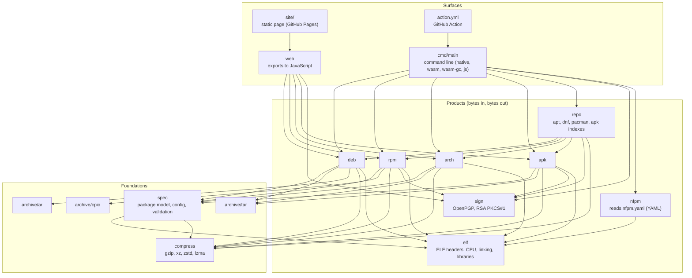

# Architecture

linuxpkg is a stack of small packages. The lower ones know nothing about files or operating systems, so the whole core runs
unchanged on the wasm, wasm-gc, js and native backends; only the command line touches the file system.

## Packages and layers

* **Foundations.** `spec` holds the one package model (`PackageSpec`), the `linuxpkg.json` parser and every validation rule
  (names, versions, paths, modes, relations). `archive/tar`, `ar` and `cpio` write and read the three container formats;
  `compress` wraps gzip, xz and zstd (and reads `.lzma`) with an unpacked-size limit checked *while* decoding.
* **Products.** `deb`, `rpm`, `arch` and `apk` turn a `PackageSpec` into the bytes of a package and read such bytes back
  (`read`, `verify`, `to_json`). `repo` builds the index files of repositories, `sign` makes and checks OpenPGP and plain RSA
  signatures. None of them reads or writes a file.
* **Surfaces.** `cmd/main` reads and writes files and parses arguments; `web` exposes `lp_inspect`, `lp_verify` and
  `lp_build` to a page; the GitHub Action downloads a release binary and calls the command line.

## From configuration to a published repository

```mermaid
flowchart LR
  cfg["linuxpkg.json<br/>+ source files"] --> spec1["PackageSpec<br/>(validated)"]
  spec1 --> arch1["archive<br/>tar / ar / cpio"]
  arch1 --> comp["compression<br/>gzip, xz, zstd"]
  comp --> pkg["package<br/>deb, rpm, pkg.tar, apk"]
  pkg --> sig1["package signature<br/>rpm header, .sig, apk stream"]
  sig1 --> idx["repository index<br/>Release, repomd.xml, .db, APKINDEX"]
  idx --> sig2["index signature<br/>InRelease, .asc, .sig"]
  sig2 --> serve["static web server<br/>(GitHub Pages)"]
  serve --> mgr["apt / dnf / pacman / apk"]
```

Every arrow is deterministic: the same inputs give the same bytes, including the signatures, because RSA PKCS#1 v1.5 and
Ed25519 contain no randomness and the signature time comes from the build time (`SOURCE_DATE_EPOCH`, `mtime`, or the
repository date) instead of the clock.

## Why MoonBit, and which features carry the design

* **One source, four backends.** Everything below `cmd/main` compiles for wasm-gc, wasm, js and native. CI builds the same
  package on all four and compares the bytes; a Windows or macOS machine, a browser tab and a Linux CI job write identical
  packages.
* **Typed errors.** Each package has its own `suberror` (`DebError`, `RpmError`, `SignError`, ...) so a function says what
  can go wrong (`raise RpmError`), and the command line maps them to exit codes (`0` ok, `1` usage or unreadable input, `2`
  integrity or signature failure).
* **Pattern matching on bytes and structure.** Header tags, the packet types of OpenPGP and the variants of a package
  (`Package::Deb | Rpm | Arch | Apk`) are enums; `match` makes it a compile error to forget a format.
* **Immutable data, value semantics.** Builders take a `PackageSpec` and return `Bytes`; nothing is mutated behind the
  caller's back, which is why "build twice, compare bytes" is a trivial test.
* **Property-style tests without a framework.** `moon test` plus a 10-line generator with a fixed seed gives repeatable
  random inputs for the round-trip tests of tar, ar, cpio, rpm headers and compression.
* **Built-in tooling.** `moon info` keeps the public interface files honest (CI fails if they drift), `moon coverage`
  measures the core, `moon package` checks what is published, `moonx` runs the released command line anywhere.

## Verification

The trust in the output does not come from the unit tests alone. `tools/oracle/run.sh` and `tools/oracle/containers.sh` give
every package and repository to the real tools (`dpkg`, `rpm`, `pacman`, `apk`, `apt`, `dnf`, `gpgv`, `openssl`) and install
them in distribution containers; see [verification.md](verification.md).
